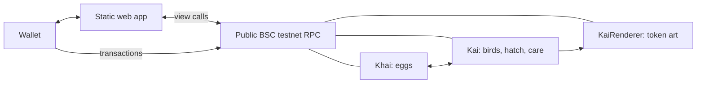

# Khai & Kai

**Khai (ไข่) = egg · Kai (ไก่) = chicken**

Sponsor a real farm chicken on BNB Smart Chain. You buy an egg, hatch it into one registered bird, and pay for its care. Everything runs on-chain with no backend.

BNB Bangkok hackathon, Developer Track, RWA theme.


## What it does

1. **Egg.** Pay 0.01 tBNB for an egg. Each wallet can buy 3 eggs per UTC day.
2. **Hatch.** Hatching draws one bird at random from the farm's pool of registered birds. You receive that bird's chicken token (an ERC-721). One bird backs exactly one token.
3. **Care.** You pay a recurring care fee (0.001 tBNB per period; the period is 1 hour on testnet and 30 days in production). The farm posts care proofs (feeding, health check, weight, vaccination, photo, note) against the bird, and they show as a timeline. A chicken with overdue care cannot be transferred until care is paid.

**Sponsorship, not ownership.** The token shows that you are the sponsor of that bird: you fund its care and see every care record. It does not give legal ownership of the animal or a right to collect it. Both are on the roadmap.

**Animal welfare.** The birds are farm and ornamental breeds. There is no fighting, no betting, no rarity tiers, and no value linked to any contest. Every bird is equal in price and in what it gets.

## What is on-chain

### Contracts

| Contract | Role |
| --- | --- |
| `Khai` | ERC-1155 egg (token id 1). Sells eggs, enforces the daily quota, holds the egg payments. |
| `Kai` | ERC-721 chicken. Bird registry and pool, hatch (commit-reveal), care fees, care proofs, transfer lock. |
| `KaiRenderer` | Builds each token's SVG image and JSON metadata on-chain. The admin can replace it. |

Code is in `contracts/contracts/`. Solidity 0.8.26, OpenZeppelin Contracts 5.

### Invariants

Each one has a test.

- **I1** Eggs in circulation plus pending hatches never exceed the pool, so every egg and every pending hatch can finish.
- **I2** Token id equals bird id. A bird leaves the pool once and is never minted twice.
- **I3** A hatch finishes at most once. Its seed depends only on the hatch id, the reveal block and that block's hash.
- **I4** The daily quota holds across both purchase paths and across split purchases.
- **I5** Each contract's balance equals payments received minus withdrawals, and only the farm role withdraws.
- **I6** Only `Kai` burns eggs for hatching, only `Khai` starts a hatch for a buyer, and only the farm role registers birds and posts care proofs.
- **I7** A token cannot be transferred while its care is overdue, and can be again once care is paid.

### The hatch draw

1. **Commit.** Starting a hatch burns one egg (or skips minting one, on the buy-and-hatch path) and records `revealBlock = block.number + 2`.
2. **Reveal.** Once `block.number > revealBlock`, anyone can call `finishHatch`. The seed is `keccak256(blockhash(revealBlock), hatchId)`. The drawn bird is the one at position `seed % pool size` in the pool, and it is swap-removed from the pool.
3. **First in, first out.** Hatches finish strictly in hatch-id order. Finishing hatch N first finishes every earlier pending hatch, so the order in which people call `finishHatch` cannot change which bird a hatch gets.
4. **Fallback.** `blockhash` only covers the last 256 blocks (about two minutes on BSC testnet). After that the seed is `keccak256(hatchId, revealBlock)` and the hatch is marked `fallback`. A pending hatch can therefore never get stuck.
5. **Check the draw.** The chicken page recomputes the seed in your browser from the block hash and compares the seed, the pool size and the pool position with what `hatchProof(hatchId)` returns. See Limitations for what this proves.

The web app sends the finishing transaction itself about 1.5 seconds after the first one confirms, so a new user confirms twice.

### Care fee and transfer lock

`payCare(tokenId, periods)` extends `carePaidUntil` by `periods x carePeriod`, starting from the later of now and the current deadline. Anyone can pay care for any chicken. Hatching includes the first period. While `now > carePaidUntil` the chicken shows Overdue and `Kai` reverts any transfer with `CareOverdue(tokenId)`. Minting is not affected.

### Token art

`tokenURI` and `uri` return base64 JSON with an SVG drawn by `KaiRenderer` from the bird's traits (10 breeds, 2 sexes, 8 plumages). The images do not depend on any server. The Solidity output matches the design kit byte for byte, and a test checks this.

| Silkie hen | Brahma rooster | Serama hen | Polish rooster |
| --- | --- | --- | --- |
|  |  |  |  |

## Live demo and deployed contracts

Live demo: pending deployment

Network: BNB Smart Chain testnet, chain id 97. Explorer: https://testnet.bscscan.com

| Contract | Address |
| --- | --- |
| Khai | [`0x2d30cb50c94387967123440c052EDc9372DA1383`](https://testnet.bscscan.com/address/0x2d30cb50c94387967123440c052EDc9372DA1383) ([Sourcify](https://repo.sourcify.dev/97/0x2d30cb50c94387967123440c052EDc9372DA1383)) |
| Kai | [`0xb3f6a0dc452e3aB7eD4D2D003926b0F32964251F`](https://testnet.bscscan.com/address/0xb3f6a0dc452e3aB7eD4D2D003926b0F32964251F) ([Sourcify](https://repo.sourcify.dev/97/0xb3f6a0dc452e3aB7eD4D2D003926b0F32964251F)) |
| KaiRenderer | [`0xd0B4AEDcAe73Efb51FE214D9DCc51910d332c1a2`](https://testnet.bscscan.com/address/0xd0B4AEDcAe73Efb51FE214D9DCc51910d332c1a2) ([Sourcify](https://repo.sourcify.dev/97/0xd0B4AEDcAe73Efb51FE214D9DCc51910d332c1a2)) |

## Try it

You need a browser wallet (MetaMask, Rabby, Trust or Binance Wallet) and some tBNB.

1. Get tBNB from the [BNB testnet faucet](https://www.bnbchain.org/en/testnet-faucet).
2. Open the live demo. All public pages work without a wallet.
3. Connect your wallet. If it is on another network, the app offers to switch to or add chain 97.
4. On the Eggs page, press Buy and hatch. Confirm the purchase, then confirm the second transaction that finishes the hatch while the hatch animation plays.
5. Open your chicken from the Coop page. You see its breed portrait, its on-chain token art, its traits and its leg-band id.
6. Pay care on the chicken page and watch the status and deadline change.
7. Press Check the draw to recompute the seed and pool position from the block hash.

Optional checks: buy a fourth egg on the same UTC day and the app shows the quota message; let the 1-hour care period lapse and the chicken shows Overdue and cannot be transferred.

## Run locally

Prerequisites: Node 22 and pnpm 11 (the repo pins `pnpm@11.25.0`).

```sh
pnpm install
```

Contract tests (32 tests, about 20 seconds):

```sh
pnpm --filter contracts test
```

Local chain, deploy, seed and export the ABI for the web app. Use separate terminals for the node and the rest:

```sh
# terminal 1: a local Hardhat node (chain 31337)
ALLOW_LOCAL=1 pnpm --filter contracts node

# terminal 2: mine a block every 450 ms, so hatches can reach their reveal block
curl -X POST -H 'content-type: application/json' \
  --data '{"jsonrpc":"2.0","id":1,"method":"evm_setIntervalMining","params":[450]}' \
  http://127.0.0.1:8545

# deploy, seed 300 sample birds, write web/src/abi/
REDEPLOY=1 pnpm --filter contracts deploy:local
pnpm --filter contracts seed:local
pnpm --filter contracts export-abi
```

`REDEPLOY=1` is needed after you restart the node, because the deploy script otherwise trusts the recorded `deployments/31337.json` and reports nothing to do.

Web app against the local node (the dev server adds a "Local test wallet"):

```sh
VITE_LOCAL=1 pnpm --filter web dev
```

Open http://127.0.0.1:5173.

Web checks (50 tests) and the static build:

```sh
pnpm --filter web typecheck
pnpm --filter web lint
pnpm --filter web test
pnpm --filter web build
```

The deploy and seed scripts refuse any chain other than 97, or 31337 with `ALLOW_LOCAL=1`. The production web build refuses `VITE_LOCAL`.

## Architecture



- **No backend.** The contracts hold all state, and the web app is static files that read view functions and send transactions through the user's wallet. There is no server to run, trust or pay for, and the token art does not depend on our hosting.
- **No `eth_getLogs`.** The official BSC testnet RPCs reject log queries, so every screen reads view functions such as `stats()`, `chickensOf()`, `hatchesOf()` and `careProofs()`. Events are still emitted for explorers. A test confirms the web source and the production bundle contain no log queries.
- **Layout.** `contracts/` (Hardhat, scripts, tests), `web/` (Vite, React, TypeScript, wagmi, viem), `design/` (SVG kit and raster art).

## Limitations

- **Randomness is block-hash based.** A caller can see the block hash before finishing a hatch, so they can choose between the block-hash result and the fallback result by waiting. A block producer can also influence a block hash. With no rarity tiers there is no better or worse bird, so this is accepted on testnet. Production needs a VRF.
- **The daily quota is per address.** A person with several wallets can buy more eggs.
- **Check the draw proves the position, not the pool contents.** It shows that the seed comes from the block hash and that the position is `seed % pool size`. The pool size and position are read from the contract. Which bird sat at that position depends on the pool at that moment, which only an archive node can show.
- **The 300 birds are invented sample data.** Their records are labelled as sample data, and no real animal is behind them.
- **Testnet only.** The contracts and scripts refuse mainnet. Testnet tBNB has no value.
- **No legal agreement.** Sponsorship has no legal agreement behind it yet.
- **Test coverage.** The contracts have 32 passing tests. The web app was tested with scripted component tests, an end-to-end test against a local chain, and browser screenshots. Wallet flows (connect, switch network, signing) have not been driven in a real browser and need a real wallet.
- **Not audited.** The contracts had an internal review only.

## Roadmap

Phase 2, in this order:

1. **Release.** After 3 overdue periods the farm can return the bird to the pool and burn the token.
2. **Redeem.** The sponsor requests the real bird and the farm confirms on-chain.
3. **Care AI agent.** An agent reads care proofs and flags gaps.

After that:

- A VRF for the hatch draw, replacing the block hash.
- A legal sponsorship agreement between sponsor and farm.
- Multiple farms, each with its own role and pool.
- Stable-value payments, so egg price and care fee do not move with the BNB price.

## Prior work

The team explored the egg-to-chicken idea in a Solana devnet demo in October 2026. This repository was written from scratch during the hackathon and shares no code, art or data with it. New here: birds are drawn without replacement (one bird, one token), the draw runs on-chain, care fees and the transfer lock are on-chain, and there is no backend.

## How it was built

This project was built during the hackathon with AI coding agents (Claude Code) and Codex for illustration and SVG design, under human direction. All art is original and was generated for this project. The prompts for the raster art are in `design/art/README.md`.

## Licence

MIT. See [LICENSE](LICENSE).
